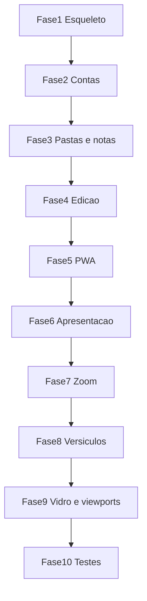

# Plano de construção — Verso

Data: 4 de novembro de 2026.
Leia [ESPECIFICACAO.md](ESPECIFICACAO.md) e [ARQUITETURA.md](ARQUITETURA.md) antes da fase 1. Este arquivo só diz a ordem. O comportamento está na especificação. As rotas, tabelas, limites e a gramática estão na arquitetura.

## Como um agente deve usar este arquivo

1. Implemente uma fase por vez, na ordem numérica.
2. Não puxe para a fase atual o que a seção "Não inclui" lista.
3. Não encerre uma fase com tela sem a verificação manual descrita nela. Viewport estreita: 390px de largura. Viewport larga: 1280px. Exercite o fluxo (clicar, digitar, enviar, navegar). Um print estático não conta.
4. Testes automatizados podem nascer junto da fase que cria a regra. A fase 10 é o portão: a versão não está pronta enquanto esses testes não passarem.
5. Não implemente o que a especificação coloca fora de escopo, mesmo que pareça pequeno.
6. Ao terminar cada fase, o `docker compose up` continua subindo o que já existia.

## Fase 1 — Esqueleto

Objetivo: três serviços sobem e a página inicial responde, sem regra de negócio.

Depende de: nada.

Não inclui: cadastro, banco além do serviço Postgres vazio, Markdown, PWA.

Arquivos:

- `compose.yaml` com `postgres`, `api` e `web`, healthcheck do Postgres, `api` espera o banco, `web` encaminha `/api` para `http://api:8000` repassando `Set-Cookie`
- `.env.example` com as variáveis da arquitetura
- `README.md` com: copiar `.env.example` para `.env`, `docker compose up`, abrir `http://localhost:5173`, health em `http://localhost:8000/api/health`
- `apps/api/pyproject.toml`, `apps/api/app/main.py` (`GET /api/health`), `apps/api/app/config.py`
- `apps/web/` SvelteKit 2 + Svelte 5 + TypeScript + Tailwind, página `/` com o título "Verso"

Pronto quando: `GET /api/health` devolve `{ "status": "ok" }` e o navegador mostra "Verso" em `http://localhost:5173`, nos dois viewports.

## Fase 2 — Contas

Objetivo: criar conta, entrar, sair, cookie de sessão.

Depende de: fase 1.

Não inclui: pastas, notas, vidro definitivo (o cartão pode ser escuro e simples; a classe `.glass` entra na fase 9 neste cartão).

Arquivos:

- modelos `users` e `sessions`, migration Alembic
- `apps/api/app/security.py`, `deps.py`, `errors.py`, `routers/auth.py`
- hash fictício de Argon2 na subida, para o login de e-mail inexistente
- `apps/web/src/routes/+page.svelte` com os dois estados do cartão
- `apps/web/src/lib/api.ts` com `credentials: "include"`

Regras a cumprir: RF-001, RF-002, RF-003, RNF-001. Mensagem única de credencial inválida, como na arquitetura.

Pronto quando:

- criar conta entra em `/app` (a rota pode ser um placeholder "área autenticada" até a fase 3)
- sair volta para `/`
- recarregar `/app` com cookie válido não pede senha de novo
- e-mail repetido e senha curta mostram erro e permanecem na tela
- verificação manual nos dois viewports: criar conta, sair, entrar com senha errada, entrar com senha certa

## Fase 3 — Pastas e notas

Objetivo: CRUD, isolamento e grade.

Depende de: fase 2.

Não inclui: editor Markdown, apresentação, versículos.

Arquivos:

- modelos `folders` e `documents`, migration, índice único de irmãos; `passages` já existe como jsonb com default `[]`, sem consulta bíblica
- `routers/folders.py`, `routers/documents.py`, `services/titles.py` (a regra de título vazio já vale no PATCH, mesmo que a UI de edição venha na fase 4)
- `routes/app/+layout.svelte`, `routes/app/+layout.ts`, `routes/app/+page.svelte`, `routes/app/pastas/[id]/+page.svelte`
- `lib/components/DocumentGrid.svelte`

Regras: RF-004, RF-005, RF-006 e RF-011 no que a grade exibe. Apagar a nota (RF-024) fica na fase 4. O rascunho de RF-007 também fica na fase 4. Nesta fase, “Nova nota” faz `POST` com corpo vazio, `passages` `[]`, e abre a rota da nota só com o título e o link de volta. A fase 4 troca esse atalho pelo rascunho. A grade já lista o título gravado e `created_at`.

Pronto quando:

- duas contas não enxergam pastas nem notas uma da outra (404 no id alheio)
- pasta dentro de pasta, trilha, nome repetido entre irmãos recusado, pasta com conteúdo recusada no delete
- grade com 1, 2 e 3 colunas nos cortes 639px, 640px e 1024px
- data em `dd/MM/yyyy`
- verificação manual nos dois viewports: criar pasta, entrar nela, criar nota, voltar pela trilha, tentar apagar pasta cheia

## Fase 4 — Edição e visualização

Objetivo: escrever Markdown, ver renderizado, gravar sozinho, e criar a nota a partir de um rascunho.

Depende de: fase 3.

Não inclui: tela cheia, zoom, gaveta, service worker, chamada à ABíbliaDigital. O `POST` desta fase grava `passages` como `[]`.

Arquivos:

- `routes/app/notas/nova/+page.svelte` — rascunho em `localStorage`, botão “Criar nota”
- `routes/app/notas/[id]/+page.svelte`
- CodeMirror 6 em modo Markdown, tema escuro indicado na arquitetura
- `lib/components/MarkdownView.svelte` com `markdown-it` (`html: false`)
- indicador e debounce de 800 ms só depois que a nota tem id
- apagar com `confirm` e volta à pasta de origem

A grade deixa de criar nota vazia. “Nova nota” abre `/app/notas/nova`.

Regras: RF-007, RF-008, RF-009, RF-010, RF-011, RF-024, RNF-004 no foco do botão de apagar e da alternância.

Pronto quando:

- o rascunho sobrevive a um recarregamento e some do `localStorage` depois de “Criar nota”
- título vazio gravado vira o primeiro heading, ou “Sem título”
- recarregar a nota devolve o texto gravado
- HTML cru digitado na nota aparece escapado, não executa
- verificação manual nos dois viewports: abrir rascunho, escrever, criar, esperar “Salvo” numa edição seguinte, alternar para ver, recarregar, apagar

## Fase 5 — PWA

Objetivo: manifesto instalável e shell em cache.

Depende de: fase 4.

Não inclui: cache de `/api/documents` ou `/api/folders`, fila offline, ícone gerado por foto externa. Gere ícones simples 192 e 512, `any` e `maskable`, no próprio repositório, em cor próxima de `#0f172a`, com o monograma "V".

Arquivos:

- configuração `@vite-pwa/sveltekit` conforme a arquitetura (`name`, `short_name`, `start_url` `/app`, `display` standalone, cores)
- ícones em `apps/web/static/`

Regras: RF-021.

Pronto quando: o manifest servido tem `display: standalone` e `start_url` `/app`, e o service worker registra em produção local (`vite build` + preview, ou o modo que o plugin exigir). No `vite dev`, se o plugin não registrar o worker, a verificação vale no preview. Confirme no navegador que o manifest abre e que os ícones respondem 200.

## Fase 6 — Apresentação

Objetivo: tela cheia, cronômetro e tópicos.

Depende de: fase 5.

Não inclui: pinça, gaveta, chamada bíblica.

Arquivos:

- `lib/topics.ts` com `splitTopics`, cobrindo o vetor de tópicos da arquitetura
- `lib/glass.css` com a classe `.glass` exatamente como na arquitetura
- `lib/components/Presentation.svelte`
- sections `data-topic-index` dentro de `MarkdownView.svelte`

A classe `.glass` já envolve cronômetro e botões de tópico. O cartão de login fica para a fase 9.

Regras: RF-012, RF-013, RF-014, RF-015. Botão próximo grande, canto inferior direito; anterior menor; os dois com nome acessível; desabilitados nos extremos. Escape fecha. Fullscreen API com queda para tela cheia simulada.

Pronto quando:

- o vetor `intro / # A / ## B / # C` avança de A para B
- `#` dentro de cerca não vira tópico
- cronômetro pausa, retoma e zera ao sair
- sair da apresentação deixa a pessoa na visualização
- verificação manual nos dois viewports: apresentar, avançar, voltar, pausar o tempo, fechar por botão e por Escape

## Fase 7 — Zoom

Objetivo: fonte com reflow, botões, pinça e Ctrl+roda.

Depende de: fase 6.

Não inclui: parser de citação.

Arquivos:

- `lib/components/ZoomBar.svelte`, usando `.glass`
- lógica de Pointer Events e `localStorage` na chave `verso.readingFontSize`

Regras: RF-016, RF-017. Limites 16, 18 e 40, passo 2. Sem `transform: scale`. `padding-bottom` da leitura para o texto não ficar atrás da barra.

Pronto quando:

- A+ e A− mudam a fonte e sobrevivem a um recarregamento
- 15 px e 41 px não ficam gravados
- pinça com dois ponteiros altera a mesma variável (no navegador, simule com o dispositivo de toque ou com dois pointers; se o ambiente não tiver toque, documente no README o que foi simulado e cubra o cálculo com teste na fase 10)
- Ctrl+roda altera a fonte e não dá zoom na página
- verificação manual nos dois viewports, com a barra sem cobrir a última linha de uma nota longa

## Fase 8 — Versículos embutidos na criação

Objetivo: na criação da nota, gravar o texto dos versículos dentro dela. A gaveta só lê esse texto.

Depende de: fase 7.

Não inclui: outro provedor, texto bíblico versionado no git, rota `/api/bible/*`, nova busca ao editar, abrir ou apresentar.

Arquivos:

- `apps/web/src/lib/books.ts` e `apps/api/app/books.py`, transcrições literais do JSON da arquitetura
- `apps/web/src/lib/citations.ts` e `apps/api/app/services/citations.py`, a mesma gramática nos dois lados; a gaveta usa a do front, o `POST` usa a do servidor
- `lib/components/VerseDrawer.svelte` com `.glass`
- modelo `bible_chapter_cache`, migration; `documents.passages` passa a ser preenchido no `POST`
- `services/bible.py`, chamado só por `routers/documents.py` no `POST`
- seletor de versão na grade, com a lista fixa da arquitetura, `PATCH /api/auth/me`

Regras: RF-018, RF-019, RF-020, RNF-002, RNF-003, RNF-006.

O `POST` agrupa por capítulo. Teste do recorte usa versículos sintéticos (`"v1"`, `"v2"`, `"v3"`), sem frase de tradução real. O teste substitui o cliente HTTP.

`BIBLE_API_TOKEN` é opcional; sem `BIBLE_API_BASE_URL`, a nota é criada assim mesmo e cada passagem fica com `bible_not_configured`. Não contornar isso com uma Bíblia embutida no repositório.

Pronto quando:

- os vetores de citação e de não citação da arquitetura estão codificados (a execução automatizada fecha na fase 10; nesta fase, rode-os ao menos uma vez)
- criar uma nota com `João 3:16-18` grava três versículos sintéticos em `passages` e o teste vê uma única leitura daquele capítulo
- abrir a mesma nota, com o cliente HTTP desligado, devolve o mesmo `passages`
- `PATCH` muda o Markdown, reaproveita as passagens já capturadas e só chama o cliente HTTP para citações novas
- tópico sem citação mostra o estado vazio
- citação no tópico seguinte não aparece enquanto o tópico atual está ativo
- citação escrita depois da criação ganha texto no próximo salvamento; passagem que falhou é buscada de novo ao abrir a nota, com toast
- a versão da conta entra nas citações naturais da criação; `[[acf:...]]` grava `acf`; mudar o seletor depois não reescreve `passages`
- verificação manual nos dois viewports: criar a nota com uma citação, abrir a gaveta, arrastar a alça, rolar para outro heading e ver a lista mudar sem rede. Com token ausente, a nota existe e a gaveta explica que o texto não foi capturado

## Fase 9 — Vidro e revisão responsiva

Objetivo: um único vidro em todos os painéis previstos e uma passagem honesta pelos fluxos.

Depende de: fase 8.

Não inclui: tema claro, componente visual novo.

Trabalho:

- aplicar `.glass` ao cartão de entrada
- conferir cronômetro, botões de tópico, barra de zoom, gaveta e alça: todos usam essa classe, nenhum ganha outro blur
- conferir `safe-area` nos controles de baixo
- repetir, em 390px e em 1280px, os fluxos: criar conta, entrar, grade, pasta, editar, ver, apresentar, zoom, gaveta, sair

Pronto quando: essa passagem termina sem controle sobrepondo o texto final da nota, sem painel flutuante opaco diferente dos outros e sem fluxo quebrado num dos dois viewports. RF-022, RF-023 e RF-025.

## Fase 10 — Testes que não podem quebrar

Objetivo: travar isolamento, tópicos, citações e recorte.

Depende de: fase 9.

Não inclui: funcionalidade nova para “facilitar o teste”.

Arquivos:

- `apps/api/tests/test_auth.py` — senha curta, e-mail duplicado, login inválido, logout
- `apps/api/tests/test_isolation.py` — duas pessoas; listar, abrir, alterar e apagar id alheio devolve 404
- `apps/api/tests/test_bible_slice.py` — capítulo sintético de três versículos no `POST` de criação. Casos do recorte: capítulo inteiro; start 2 end 3; start 3 end 1 vira 1–3; start 2 end nulo vira só o 2; duas citações do mesmo capítulo disparam uma única leitura. O `GET` seguinte, com o cliente HTTP desligado, devolve o texto gravado. O `PATCH` não chama o cliente e não muda `passages`
- `apps/web` Vitest em `topics.ts` e `citations.ts` com todos os vetores da arquitetura
- teste que `books.ts` e `books.py` têm as mesmas 66 abreviações e os mesmos números de capítulos, com Tito em 3 e Filemom em 1

Pronto quando: `pytest` na API e `vitest` no front terminam sem falha. Aí a versão 1 está pronta, no critério da especificação.

## Ordem que não se inverte

## Fora de todas as fases

GitHub, offline das notas, compartilhamento, busca, lixeira, tema claro, PDF, mover nota de pasta, WYSIWYG, nova consulta bíblica depois da criação e troca de provedor bíblico.
